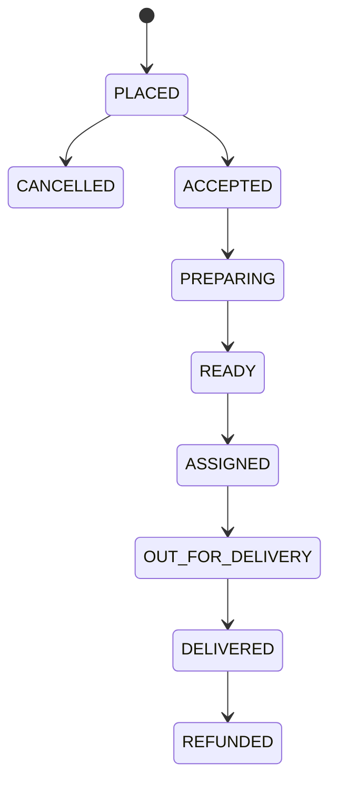

# CampusBite

CampusBite is a campus restaurant ordering and delivery app. Students browse kitchens, place orders with a dummy payment, and track them live. Restaurant owners manage menus and orders. Delivery partners update the runs assigned to them. An admin manages people and restaurants.

## Technologies

- Frontend: React 18, React Router, Axios, Vite
- Backend: Python, FastAPI, Pydantic, SQLAlchemy, JWT, bcrypt
- Database: PostgreSQL
- Realtime: WebSockets for order status
- AI: OpenAI chat completions, using the signed-in student's own orders as context
- Containers: Docker and Docker Compose for the API and database

## Features

- Customer registration and login, plus admin-issued owner and delivery accounts
- Restaurant listing, menu search, and price filters
- Cart, dummy checkout, order history, cancellation while an order is still `PLACED`
- Order lifecycle: `PLACED` → `ACCEPTED` → `PREPARING` → `READY` → `ASSIGNED` → `OUT_FOR_DELIVERY` → `DELIVERED`, plus `CANCELLED` and `REFUNDED`
- Reviews after delivery, and one return/refund request per delivered order
- Owner menu management, order filters, delivery assignment, statistics, and stale-order reminders
- Delivery dashboard limited to assigned orders
- Admin management for customers, owners, delivery partners, and restaurants
- AI order insights for the authenticated customer only
- Request logging middleware and a background reminder task (orders in `PLACED` or `ACCEPTED` for more than 15 minutes)

## Demo accounts

Created automatically the first time the database is empty.

| Role | Email | Password |
| --- | --- | --- |
| Admin | admin@campusbite.com | Admin@123 |
| Owner (North Court Mess, Library Lawn Cafe) | owner@campusbite.com | Owner@123 |
| Owner (The Byte Burger, Noodle Window) | owner2@campusbite.com | Owner@123 |
| Delivery | delivery@campusbite.com | Delivery@123 |
| Delivery | sana.delivery@campusbite.com | Delivery@123 |
| Customer | customer@campusbite.com | Customer@123 |

The customer account already has a mix of delivered, in-progress, and cancellable orders so each dashboard has something to show.

## Run the backend with Docker Compose

From the repository root:

```bash
cp .env.example .env
docker compose up --build
```

- API: http://localhost:8001
- Interactive docs: http://localhost:8001/docs
- Health: http://localhost:8001/api/health
- Postgres is published on `localhost:5433` (container port 5432) so it does not collide with a Postgres already running on the machine

Compose starts PostgreSQL, waits until it is healthy, then starts the API. On startup the API creates tables and seeds demo data if the `users` table is empty.

Stop it with `docker compose down`. Add `-v` if you also want to delete the database volume.

## Run the frontend locally

```bash
cd frontend
npm install
npm run dev
```

Open http://localhost:5173. The Vite dev server proxies `/api` (including the WebSocket) to `http://localhost:8001`.

## Environment variables

Copy `.env.example` to `.env`. Do not commit `.env`.

| Variable | Purpose |
| --- | --- |
| `POSTGRES_USER`, `POSTGRES_PASSWORD`, `POSTGRES_DB` | Database credentials for the Postgres container |
| `DATABASE_URL` | SQLAlchemy URL when the API runs on the host. Compose overrides this so the container uses hostname `db` |
| `JWT_SECRET` | Signing key for access tokens |
| `JWT_ALGORITHM` | Default `HS256` |
| `ACCESS_TOKEN_EXPIRE_MINUTES` | Token lifetime |
| `CORS_ORIGINS` | Comma-separated frontend origins |
| `OPENAI_API_KEY` | Optional. When empty, insights are calculated from the student's orders and labeled as a local summary |
| `OPENAI_MODEL` | Default `gpt-4o-mini` |
| `REMINDER_STALE_MINUTES` | How long an order can sit in `PLACED` or `ACCEPTED` before a reminder |
| `REMINDER_INTERVAL_SECONDS` | How often the reminder scan runs |
| `AI_REQUESTS_PER_MINUTE` | Per-user cap for the insights endpoint |

`frontend/.env.example` only has `VITE_API_URL`. Leave it empty in development.

## Database

Tables: `users`, `restaurants`, `menu_items`, `orders`, `order_items`, `order_status_events`, `reviews`, `payment_ledger`, `return_requests`, `reminder_logs`.

Relationships:

- A customer has many orders
- A restaurant has many menu items and orders, and belongs to one owner
- An order has many items, many ledger rows, many status events, and at most one review and one return request
- A delivery partner can be assigned to many orders

Schema is created with SQLAlchemy `create_all` when the API starts. This project does not ship Alembic migrations.

To run the API on the host instead of in Docker, start only the database (`docker compose up db`), create `.env` from the example, then:

```bash
cd backend
python -m venv .venv
source .venv/bin/activate
pip install -r requirements.txt
uvicorn app.main:app --reload --port 8001
```

## API documentation

FastAPI publishes the full schema at `/docs`. Protected routes expect `Authorization: Bearer <token>`. The token from login or registration is stored in `localStorage` and sent by the frontend.

Main groups:

- `POST /api/auth/register`, `POST /api/auth/login`, `GET /api/auth/me`
- `GET /api/restaurants`, `GET /api/restaurants/{id}/menu`, `GET /api/restaurants/{id}/reviews`
- `GET/POST /api/menu`, `PUT /api/menu/{id}`, `PATCH /api/menu/{id}/availability`, `DELETE /api/menu/{id}`
- `POST /api/orders`, `GET /api/orders`, `GET /api/orders/{id}`
- `POST /api/orders/{id}/status`, `POST /api/orders/{id}/assign`, `POST /api/orders/{id}/review`
- `POST /api/returns/orders/{id}`, `GET /api/returns`, `POST /api/returns/{id}/decision`
- `GET /api/ai/snapshot`, `POST /api/ai/insights`
- `GET /api/owner/stats`, `GET /api/owner/reminders`, `GET /api/owner/partners`
- `GET/POST /api/admin/users`, `PATCH /api/admin/users/{id}`
- `GET/POST /api/admin/restaurants`, `PATCH /api/admin/restaurants/{id}`
- WebSocket `GET /api/ws?token=...` for live order and reminder events

Status changes that skip a step are rejected. Customers can cancel only from `PLACED`. Owners assign a delivery partner only from `READY`. Delivery partners can move only their own orders from `ASSIGNED` to `OUT_FOR_DELIVERY` to `DELIVERED`.

## Order flow


